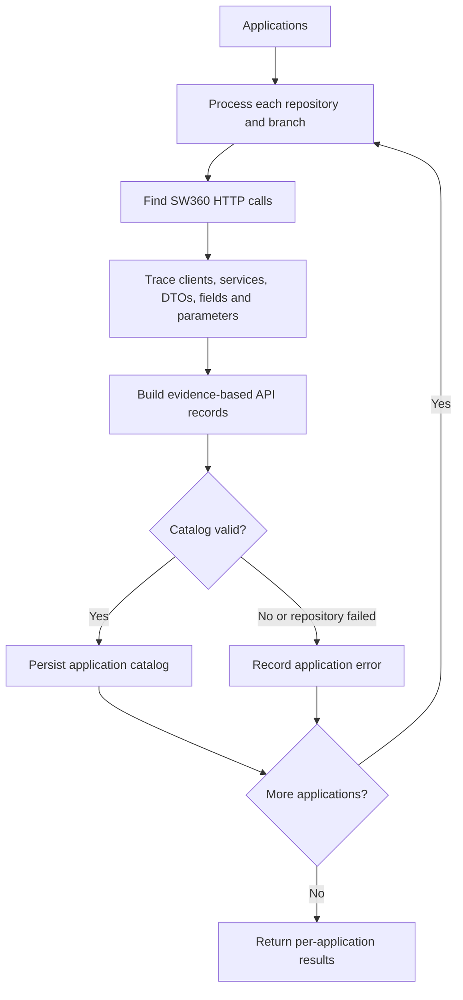

# Application Dependency Scanner

Scan each supplied application repository and produce a source-backed catalog of its SW360 API contracts for the Compatibility Analyzer. Treat repository source as authoritative; never invent endpoints, DTOs, fields, parameters, or authentication details.

## Input

```json
{
  "applications": [
    { "application": "continuous-clearing", "repository": "https://github.com/siemens/continuous-clearing", "branch": "main" },
    { "application": "vector", "repository": "https://siemens.ghe.com/portfolio/acdc-tc-vector", "branch": "main" }
  ]
}
```

## Workflow



For each input, scan only the specified branch. Search SW360 hosts, base URLs, endpoint paths, and wrapped client/service calls. Recognize HTTP clients such as RestTemplate, WebClient, Feign, HttpClient, OkHttp, axios, fetch, Refit, and RestSharp. Trace indirect calls where source evidence allows; include relevant client and service file paths.

For each API call, record the HTTP method and normalized path, request/response DTOs, path/query/header parameters, and authentication configuration when identifiable. Derive fields from source DTO declarations and serialization annotations, not examples or representative samples. `requestFields` and `responseFields` must enumerate every serialized field on every associated DTO, including inherited fields and fields from each DTO used by the API. Include nested object fields as dotted paths (for example, `externalIds.purl.id`)  elements as `items[].field`. Include wrapper, pagination, and HALand collection fields when modeled. For dynamic dictionaries or extension data, include the map field and a wildcard path (for example, `additionalData.*`); never guess dynamic keys. Do not list computed or ignored properties as serialized fields. For raw/untyped payloads, record only fields proven by parsing, schema, or usage; otherwise use an empty list and explain the unknown shape in `fieldNotes`. Use empty arrays for unsupported or undiscovered lists; leave authentication empty when unknown. Set confidence from the strength of source evidence, not guesswork.

## Catalog Format

Write one file per successful application to `catalogs/<application>-api-catalog.json`:

```json
{
  "application": "",
  "repository": "",
  "branch": "",
  "generatedAt": "",
  "apis": [
    {
      "apiId": "GET:/projects/{id}",
      "method": "GET",
      "path": "/projects/{id}",
      "clientFiles": [],
      "serviceFiles": [],
      "requestDtos": [],
      "responseDtos": [],
      "requestFields": [],
      "responseFields": [],
      "fieldNotes": [],
      "parameters": [],
      "authentication": "",
      "confidence": "High"
    }
  ]
}
```

Use `apiId` as `<METHOD>:<path>` and keep all file paths repository-relative. Group repeated calls to the same method and normalized path into one record, combining observed files, DTOs, fields, and parameters without duplicates.

If a repository or branch fails, return a per-application JSON error containing `application`, `repository`, `branch`, `status: "Failed"`, and a concise `error`; continue processing the remaining inputs. Persist successful catalogs even when another application fails. Return only evidence-based results suitable for SW360 compatibility analysis.