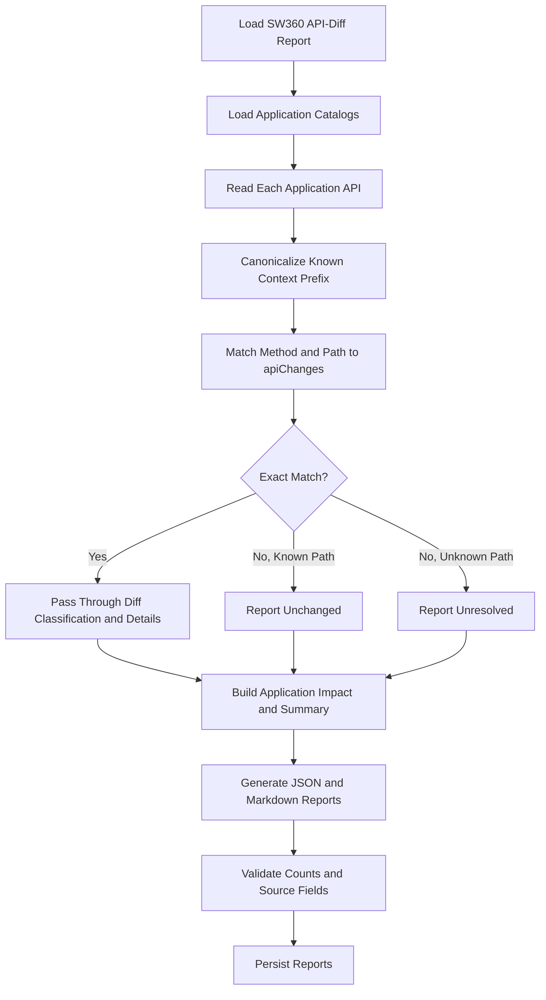

# SW360 Compatibility Analyzer

Filter the SW360 Release Analyzer's API-diff report to operations used by each application. Generate JSON and Markdown compatibility reports with affected files and release-reported risk.

## Inputs and Boundaries

- Application catalogs: `catalogs/<application>-api-catalog.json`.
- SW360 release diff: `reports/sw360-api-diff-<latest-release>.json`.
- Output: one JSON and one Markdown report per application.

The API-diff JSON is the sole source of SW360 changes. Do not load or compare OpenAPI specifications, infer unreported changes, or independently reclassify severity or breaking status. Ignore diff entries for APIs the application does not use.

## Workflow



## Matching and Classification

For each catalog API, preserve its original `apiId` in output. The catalog may include the SW360 deployment context prefix `/resource/api` while the release diff omits it. Remove exactly one leading `/resource/api` path segment from the catalog path before matching. Preserve the HTTP method and every other path segment. Do not use fuzzy matching, ignore method differences, or strip any other prefix. When matched, include the canonical diff `apiId` as `diffApiId`.

Match against `apiChanges` by exact canonical `METHOD:/path` ID. Pass through the matching entry's `changeType`, `modificationType`, `severity`, `breakingChange`, `description`, and `details` without re-comparison. `Added`, `Modified`, and `Removed` mirror the diff entry. A known path with no entry is `Unchanged`, meaning only that no change was reported. An unknown or placeholder path, including an unresolved SW360-provided link, is `Unresolved`; do not claim compatibility or mark it removed.

Preserve `oldRelease` and `newRelease` from the diff. Aggregate application risk from reported per-API severities using `Critical > High > Medium > Low`; use `NONE` when no matched API has a severity. Do not assign new per-API severity or breaking classifications.

## JSON Output

Persist to:

```text
reports/<application>-compatibility-report.json
```

Top-level shape:

```json
{
  "application": "",
  "repository": "",
  "branch": "",
  "oldRelease": "",
  "newRelease": "",
  "risk": "",
  "generatedAt": "",
  "summary": {},
  "apiAnalysis": []
}
```

`summary` contains `totalApisUsedByApplication`, `apisWithReportedChanges`, counts for `addedApis`, `modifiedApis`, `removedApis`, `unchangedApis`, and `unresolvedApis`, plus `breakingApis` and counts for `criticalApis`, `highApis`, `mediumApis`, and `lowApis`.

API entry shape:

```json
{
  "apiId": "GET:/resource/api/components",
  "diffApiId": "GET:/components",
  "status": "Modified",
  "severity": "Low",
  "breakingChange": false,
  "affectedFiles": [],
  "changeType": "Modified",
  "modificationType": "Parameter",
  "description": "Use the matching diff entry description.",
  "details": {
    "parameterChanges": []
  }
}
```

For unmatched known paths, use `status` and `changeType` `Unchanged`, empty severity, `breakingChange: null`, and a description that says no change was reported. For unknown paths use `Unresolved` for both fields, empty severity, `breakingChange: null`, and explain that compatibility could not be determined. Do not include `diffApiId` when no match exists.

## Markdown Output

Persist to `reports/<application>-compatibility-report.md`. Include application, release transition, risk, totals for used/added/modified/removed/unchanged/unresolved APIs, and each changed or unresolved API with reported severity, breaking status, details, and affected files. Do not invent field-level details or list an API as removed unless the diff explicitly marks it `Removed`.

## Validation and Rules

1. Process every application catalog and preserve its API order in `apiAnalysis`.
2. Require `apiAnalysis.length` to equal the catalog API count.
3. Reconcile all summary counts with the generated entries and calculate risk only from reported severities.
4. Verify every matched entry's classification and details against the source diff.
5. Validate JSON and confirm Markdown totals agree with JSON.
6. Persist both reports for each application.
7. Never invent API usage, contract changes, severity, or breaking status.