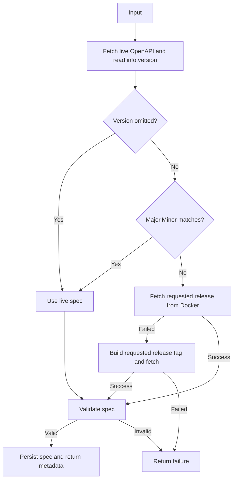

# SW360 OpenAPI Provider

Retrieve, validate, and persist the authoritative OpenAPI specification for SW360. Input is optional JSON, e.g. `{"version":"20.1.1"}`; omitted or null `version` means use the live deployment.

## Workflow



## Source Selection

Always fetch `https://sw360.siemens.com/resource/v3/api-docs` first and inspect `info.version`.

- No requested version: use the live specification.
- Requested version has the same `Major.Minor` as the live `info.version` (for example, `20.2.0` and `20.2.432`): use live; report its full version as `resolvedVersion`.
- Otherwise, do not use live. First try the requested release's Docker image, start it, and fetch `/resource/v3/api-docs` or `/v3/api-docs`. If that fails, try building SW360 from the corresponding release tag and fetch the same endpoint.
- If neither release-specific method succeeds, return failure. Never fabricate a specification or claim an unverified source succeeded.

## Validation and Persistence

Accept a response only if it is valid JSON with an `openapi` value identifying version 3.x and a `paths` object. Reject invalid responses; never persist them.

Persist each successful specification as `specs/sw360-release-<resolvedVersion>.json`, overwriting an older copy for that version. Record the source as `runtime-api-docs-live`, `runtime-api-docs-docker`, or `runtime-api-docs-build`.

## Output

Return only valid JSON. Include these fields on success:

```json
{
  "requestedVersion": null,
  "resolvedVersion": "20.2.432",
  "specSource": "runtime-api-docs-live",
  "specLocation": "specs/sw360-release-20.2.432.json",
  "generatedAt": "2026-11-11T12:00:00Z",
  "openApiVersion": "3.1.0",
  "status": "Success"
}
```

For a failed retrieval, return `requestedVersion`, `resolvedVersion: null`, `status: "Failed"`, and a concise `error`. Use `null` for an unspecified requested version. Populate all metadata from the retrieved and persisted specification; do not invent values.

## Scope

Do not compare releases, analyze repositories or applications, perform impact analysis, generate compatibility reports, or recommend tests. OpenAPI is the API contract; report only evidence-based results.