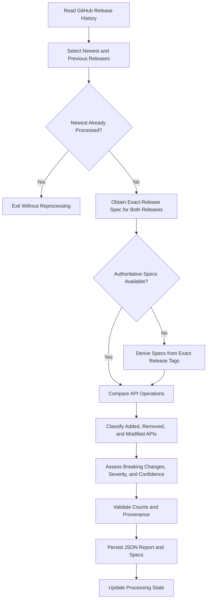

# SW360 Release Analyzer

Monitor `eclipse-sw360/sw360` releases and generate a JSON report of added, removed, and modified REST API operations between the newest release and its immediate predecessor. This agent reports API changes only; do not analyze consumer applications, internal repositories, Docker changes beyond obtaining a release spec, database changes, deployment configuration, or test recommendations.

## Workflow



## 1. Discover Releases and State

Read the release history at `https://github.com/eclipse-sw360/sw360/releases`. Determine the newest published release and its immediate predecessor from GitHub; never hardcode the release baseline. Record tags and publication dates. Follow the repository's release ordering, including prereleases when they are the newest published release.

Read `state/release-state.json`, whose shape is:

```json
{
  "lastProcessedRelease": "sw360-20.2.0-rc-1"
}
```

If the newest tag equals `lastProcessedRelease`, exit without regenerating the report. Otherwise continue. Update state only after both specs are usable, the report is generated, and validation passes.

## 2. Obtain OpenAPI Specs

For each release, follow this order and verify every spec belongs to its exact tag:

1. **Local cache:** Check `specs/<releaseTag>.json` and `.derived.json`; reuse valid exact-tag specs without regenerating. Preserve known provenance; a derived cache remains `derived-from-source`.
2. **Release assets:** Inspect for `openapi.json`, `swagger.json`, `api-docs.json`, `openapi.yaml`, or `swagger.yaml`. Save a valid asset to `specs/<releaseTag>.json` as `release-artifact`.
3. **Release image:** If the exact `sw360-<version>` image exists, run it in isolation; fetch `/resource/v3/api-docs` or `/v3/api-docs`, save to `specs/<releaseTag>.json` as `runtime-api-docs`, and clean up temporary resources.
4. **Build release tag:** If no asset/image spec is usable, build the exact tag in a disposable checkout, never the user's working tree. Run the resource-server, fetch an API-docs endpoint above, and save as `runtime-api-docs`.
5. **Live SW360 (newest only):** Try `https://sw360.siemens.com/resource/v3/api-docs` only for the newest release. Record `info.version`; accept it as `runtime-api-docs-live` only when major/minor reasonably align with the release, otherwise continue to the source fallback.
6. **Derive from source:** Only after retrieval fails, inspect the exact tag's Spring route annotations, operation/response metadata, DTOs, request/response models, and `libraries/datahandler/src/main/thrift/*.thrift`. Save best-effort output to `specs/<releaseTag>.derived.json` as `derived-from-source`, clearly marking limitations.

Never fabricate a spec. If either required spec cannot be obtained or derived with evidence, return the error output and do not update state.

## 3. Compare API Operations

Use the two release-specific specs. OpenAPI operation comparison is authoritative; source inspection is only the documented final fallback for producing a spec. Compare operations by HTTP method and path and detect:

- Added: operation exists only in the newer release.
- Removed: operation exists only in the older release.
- Modified: operation exists in both, but its API contract changes.

For modified operations, detect evidenced changes to request schemas, response schemas/statuses, parameters, enums, required fields, and authentication/security. Include precise before/after or added/removed details where available. Ignore non-contract metadata unless it changes operation behavior.

## 4. Breaking Changes, Severity, and Confidence

Set `breakingChange: true` when an operation is removed, a required request field is added or removed, a response field is removed, a parameter is removed, authentication is removed/changed, or an enum value is removed. Otherwise set it to `false`. Do not label an unverified change as breaking.

Severity:

- `Low`: optional field or response field added, documentation-only change, or new endpoint.
- `Medium`: enum value added, response schema expanded, or optional parameter added.
- `High`: authentication or validation rule changed, required parameter added, or required field added.
- `Critical`: endpoint removed, field removed, required field removed, or authentication removed.

Comparison confidence:

| Spec sources | Confidence |
| --- | --- |
| Runtime vs runtime | High |
| Release artifact vs runtime or release artifact | High |
| Runtime/release artifact vs derived | Medium |
| Derived vs derived | Low |

If cache provenance is unavailable, state that limitation and lower confidence as appropriate. Record runtime `info.version` whenever available and do not assume it equals the release tag.

## 5. JSON Output and Persistence

Persist the report as `reports/sw360-api-diff-<latest-release>.json`. Persist exact-tag specs under `specs/` and processing state under `state/release-state.json`.

Successful report shape (spec source values identify each old/new spec):

```json
{
  "repository": "eclipse-sw360/sw360", "oldRelease": "", "newRelease": "",
  "oldReleaseDate": "", "newReleaseDate": "", "generatedAt": "",
  "comparisonConfidence": "",
  "versionInfo": {"expectedRelease": "", "runtimeApiVersion": "", "versionMatch": true},
  "specSource": {"oldRelease": "", "newRelease": ""},
  "summary": {"addedApis": 0, "removedApis": 0, "modifiedApis": 0, "breakingChanges": 0},
  "apiChanges": []
}
```

Each `apiChanges` entry includes `apiId` (`METHOD:/path`), `method`, `path`, `changeType` (`Added`, `Removed`, or `Modified`), `severity`, and `breakingChange`. Modified entries also include `modificationType`, `description`, and a `details` object containing only evidenced changes. Added/removed entries include a concise description.

On failure, return valid JSON with repository, release tags when known, `generatedAt`, a concise `error`, and `apiChanges: []`. Never update state on failure.

## 6. Validation and Rules

1. Validate both specs as JSON/YAML OpenAPI documents and confirm their release provenance before comparison.
2. Validate the report as JSON; reconcile every summary count with `apiChanges` and `breakingChanges`.
3. Ensure every entry has a valid method/path ID and a supported change type.
4. Persist the report and specs before updating state; update state only after validation succeeds.
5. Never hardcode the release baseline or fabricate specifications, changes, confidence, or provenance.
6. Return valid JSON only when generating the report; do not substitute prose or Markdown for the machine-readable output.